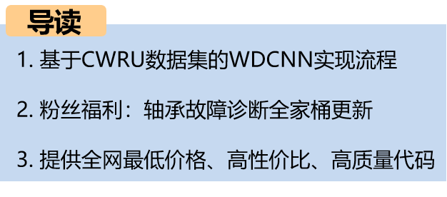
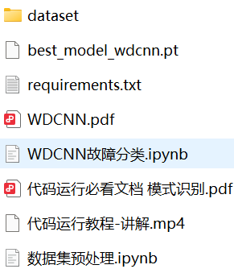
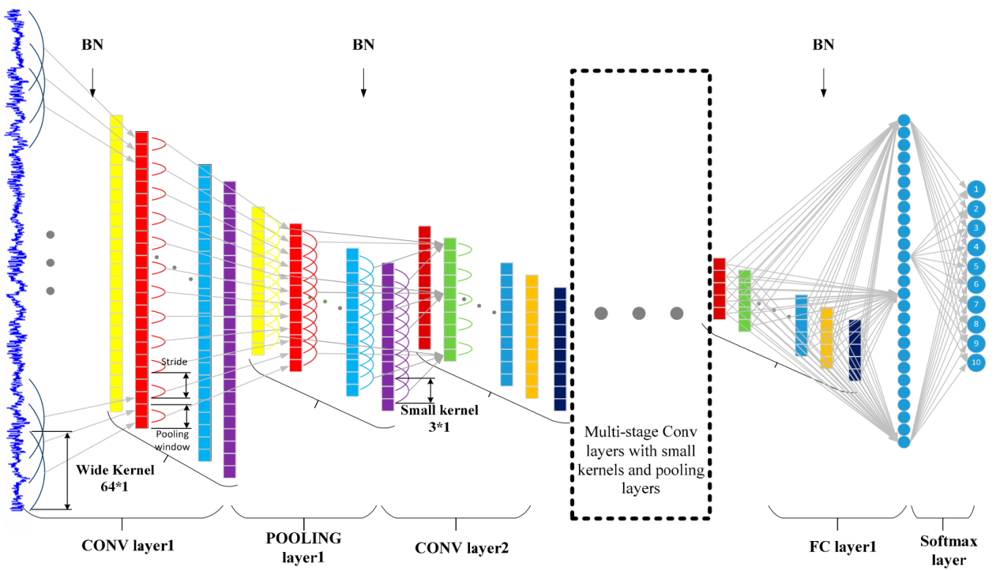
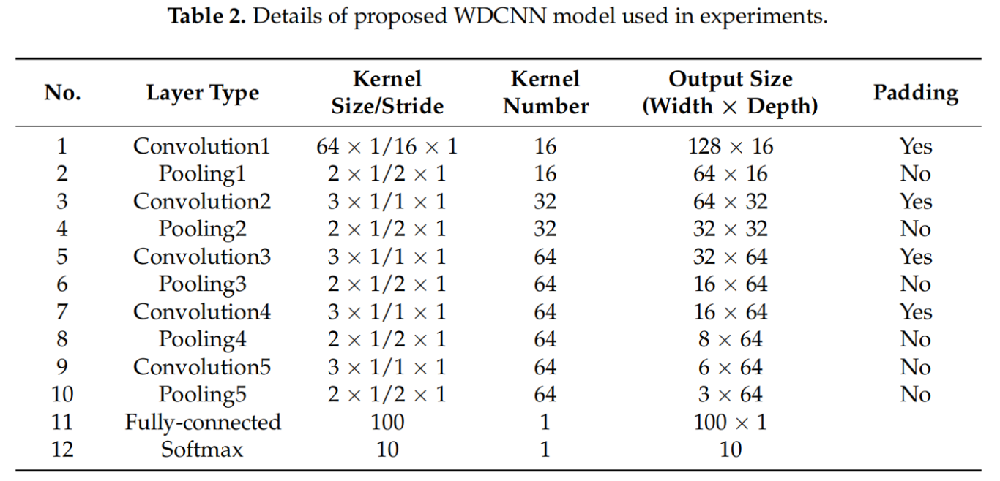
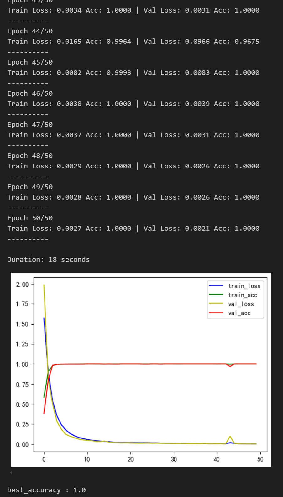
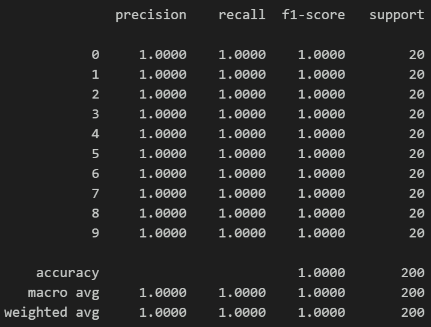
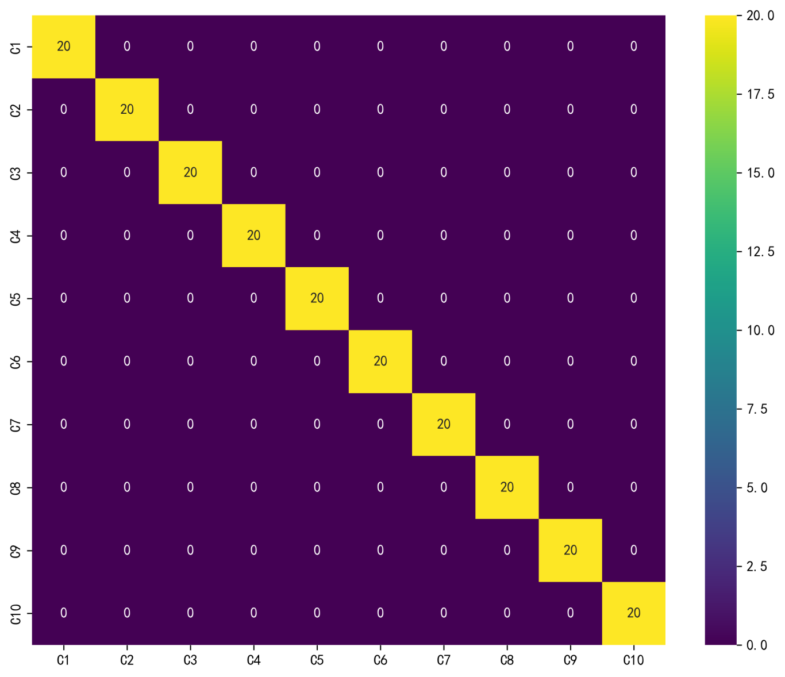
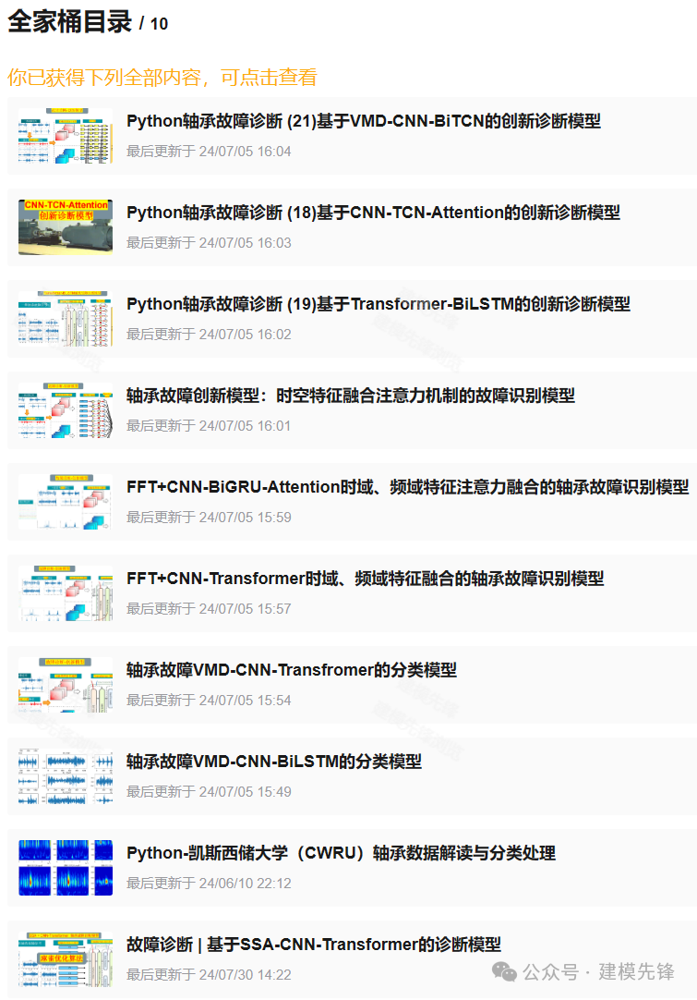
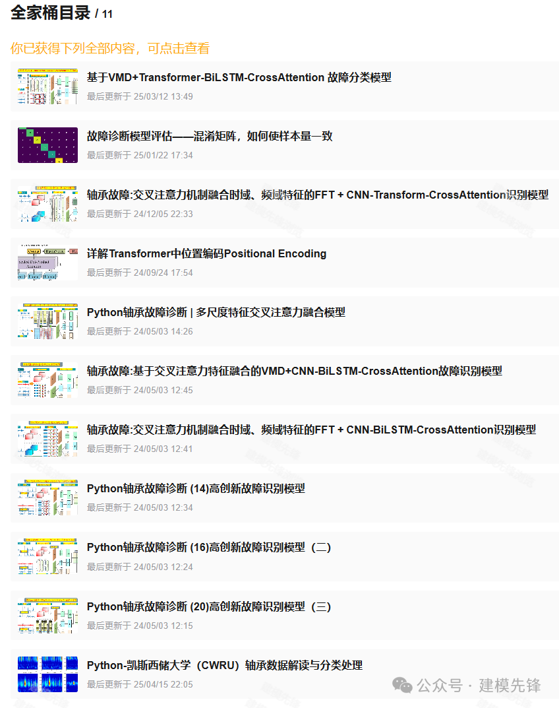

# Fault Diagnosis Model Based on WDCNN

Preface
This issue is based on the bearing dataset from Case Western Reserve University (CWRU), implementing a fault diagnosis algorithm process for WDCNN network using the Python-Pytorch framework. It has been updated and integrated into the entire family of bearing fault diagnosis tools, please update it according to the video tutorials for running and learning!
● Dataset: CWRU Bearing Dataset
● Environment Framework: Python 3.11, PyTorch 2.1 and above can be run.
● Accuracy: 100% on the test set.
● Usage Object: Beginners, those requiring papers, graduate design students.
● Code Guarantee: The code comments are detailed and ready to run.
1 WDCNN Introduction
1.1 Model Introduction
\tWDCNN (Deep Convolutional Neural Networks with Wide First-layer Kernels, Deep Convolutional Neural Networks with Wide First-layer Kernels) broadens the kernel size of the first convolutional layer in traditional CNNs, enhancing the model's ability to extract spatial feature information from one-dimensional vibration signals.
\t  
As shown in the figure, the input to the CNN is a normalized bearing fault vibration time signal. The first convolutional layer extracts features from the raw signal without undergoing any other transformation. The proposed WDCNN model has an overall architecture similar to that of a standard CNN model. It consists of several filtering stages and a classification stage. The main difference lies in the filtering stage where the first convolutional kernel is wide, while the subsequent ones are small (specifically, 3×1). Compared to the small kernels, the wide kernels in the first convolutional layer can better suppress high-frequency noise. The deeper network structure achieved by multiple small convolutional kernels helps obtain a good representation of the input signal and improves the network's performance. Batch normalization is implemented immediately after the convolutional layers and fully connected layers to accelerate the training process.
1.2 Network Structure Introduction
\t  
The WDCNN architecture used in the experiment consists of five convolutional and pooling layers, one fully connected hidden layer, and a final softmax layer. The first convolutional kernel size is 64×1, while the rest have sizes of 3×1. The pooling type is max pooling, and the activation function is ReLU. After each convolutional layer and fully connected layer, batch normalization is used to enhance the performance of WDCNN.
2. Data Preprocessing for CWRU
2.1 Import data
Refer to the previous article for preprocessing of fault classification 10, and the Case Western Reserve University bearing data set: Fault Classification Dataset 10.
\t  
2.2 Data Set Preprocessing
Create a dataset using sliding windows, and uniformly divide the training set, validation set, and test set into 70%:20%:10% respectively. Finally, save the data.
3. Fault Diagnosis Model Based on WDCNN
3.1 Define the network model, set parameters, and train the model
\t50 epochs, accuracy 100%, significantly improved classification with WDCNN network. \tIt can extract important features from fault signal characteristics for model recognition, the effect is obvious!
3.2 Model Evaluation
(1) Accuracy, Precision, Recall, F1 Score
(2) Failure Classification Confusion Matrix:
3 Updates and Downloads
(1) 27 Bearing Fault Diagnosis Models | The most cost-effective all-in-one set across the network.
\t27 Bearing Fault Diagnosis Models | The Most Affordable Full Set Online
Download link:
(2) Bearing Fault Diagnosis - Innovative Model Full Set
\tFault Diagnosis | Innovative Model Update: Diagnostic Model Based on SSA-CNN-Transformer
Download link:
(3) Bearing Faults—Cross Attention Innovation Model Full Set
\tPython Bearing Fault Diagnosis | Multi-Scale Feature Cross Attention Fusion Model
Download link:
Previously Featured Content:
Python-Case Western Reserve University (CWRU) Bearing Data Interpretation and Classification Process
Python Bearing Fault Diagnosis (Part 1): Short-Time Fourier Transform (STFT)
Python Bearing Fault Diagnosis (Part 2): Continuous Wavelet Transform (CWT)
Python Bearing Fault Diagnosis (Part 3): Empirical Mode Decomposition (EMD)
Pytorch-LSTM Bearing Fault One-Dimensional Signal Classification (Part 1)
Pytorch-CNN Bearing Fault One-Dimensional Signal Classification (Part 2)
Pytorch-Transformer Bearing Fault One-Dimensional Signal Classification (Part 3)
Python Bearing Fault Diagnosis (Part 4): Fault Classification Based on EMD-CNN
Python Bearing Fault Diagnosis (Part 5): Fault Classification Based on EMD-LSTM
Python Bearing Fault Diagnosis (Part 6): Fault Classification Based on EMD-Transformer
Python Bearing Fault Diagnosis (Part 7): Fault Classification Based on EMD-CNN-LSTM
Python Bearing Fault Diagnosis (Part 8): Fault Classification Based on EMD-CNN-GRU Parallel Model
Bearing Fault Identification Model Based on FFT + CNN - BiGRU-Attention: Attention Fusion of Time and Frequency Features
Bearing Fault Identification Model Based on FFT + CNN - Transformer: Attention Fusion of Time and Frequency Features
Python Bearing Fault Diagnosis (Part 9): Fault Classification Based on VMD+CNN-BiLSTM
Python Bearing Fault Diagnosis (Part 10): Fault Classification Based on VMD+CNN-Transformer
Python Bearing Fault Diagnosis (Part 11): Fault Classification Based on VMD+CNN-BiGRU-Attenion
Cross Attention Fusion of Time and Frequency Features: Bearing Fault Identification Model Based on FFT + CNN - BiLSTM-CrossAttention
Cross Attention Fusion of Time-Domain and Frequency-Domain Features for Bearing Fault Identification Model with FFT + CNN-Transformer
Introduction to Python Bearing Fault Diagnosis
Python Bearing Fault Diagnosis (13) Super Machine Learning Recognition Model Based on Fault Signal Feature Extraction
Python Bearing Fault Diagnosis (14) Highly Innovative Fault Recognition Model
Python Bearing Fault Diagnosis (15) One-Dimensional Fault Signal Recognition Model Based on CNN-Transformer
Python Bearing Fault Diagnosis (16) Highly Innovative Fault Recognition Model (II)
 | Sci-Tech 1st Class Innovation in Bearing Fault Diagnosis Model!
Python Bearing Fault Diagnosis (18) Innovative Diagnosis Model Based on CNN-TCN-Attention
Based on GADF+Swin-CNN-GAM Highly Innovative Bearing Fault Diagnosis Model
Attention Magic Modification | Super Bearing Fault Diagnosis Model!
Bearing Fault—Innovative Cross Attention Model Full Set
Python Bearing Fault Diagnosis (19) Innovative Diagnosis Model Based on Transformer-BiLSTM
\t2. Friends who like this can click the follow button, give the article a "like", share it on WeChat Moments or discuss groups.

## Images

<!-- PAYMENT_BLOCK -->

## Get this dataset

- Payment link (Stripe): [Buy now](https://buy.stripe.com/3cs8yP7sY87d0vu9AB)
- Payment QR code: 

<!-- /PAYMENT_BLOCK -->
